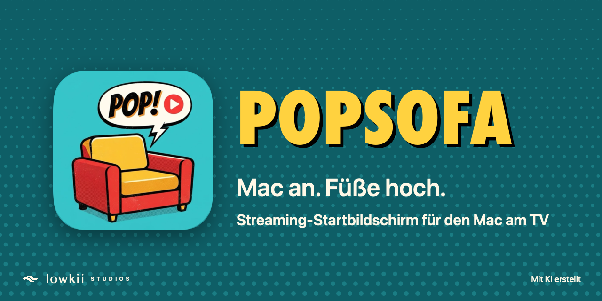
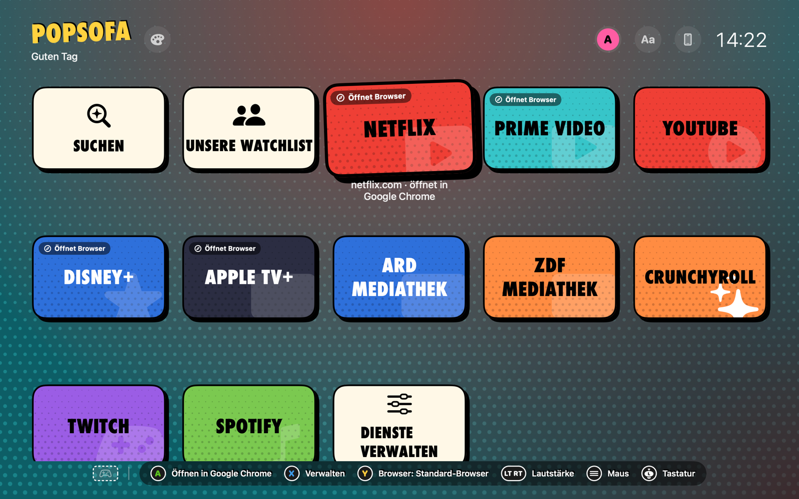

# PopSofa

**Mac an. Füße hoch.** PopSofa ist der Streaming-Startbildschirm für den Mac am Fernseher. Du wählst deine Dienste mit dem Xbox-Controller oder dem iPhone aus, die Tastatur kann im Schrank bleiben.

**[PopSofa für den Mac laden](https://github.com/lowkii-studio/popsofa/releases/latest)** · macOS 13 oder neuer · Apple Silicon und Intel · kostenlos für nicht-kommerzielle Nutzung

*English: PopSofa is a free streaming launcher (source available, noncommercial use) for a Mac connected to your TV. Navigate with an Xbox controller or use your iPhone as a remote, no app install needed. The interface is available in German, English and Portuguese.*

## Für wen

Für alle, die einen Mac mini oder ein MacBook am Fernseher haben und abends nicht mit Maus und Tastatur auf dem Sofa sitzen wollen.

- **Deine Dienste auf einem Bildschirm:** Netflix, Prime Video, Disney+, ARD, ZDF, YouTube und eigene Seiten. Abos und Logins bleiben bei den Diensten.
- **Controller oder iPhone:** auswählen, scrollen, tippen, diktieren.
- **Mehrere Profile:** eigene Dienste und Merklisten, dazu eine gemeinsame Watchlist.
- **Lesbar vom Sofa:** Schriftgröße, Kontrast und Farben pro Profil.

## Was PopSofa besonders macht

PopSofa ist ein Experiment von lowkii studios: ein Launcher, der sich an die Person anpasst, die davor sitzt – nicht umgekehrt. Er ist keine Diagnose und kein Medizinprodukt, die Tests helfen nur bei der Einstellung der Darstellung.

- **Anpassung an Sehvermögen und Sitzabstand:** Eine Kamera misst einmalig etwa 3 Sekunden lang den Abstand zum Gesicht (es werden keine Bilder gespeichert). Aus Abstand, Bildschirmgröße und einem kurzen Sehtest im Profil berechnet der Modus „Auto“ die Textgröße stufenlos. Die Messung arbeitet mit festen Näherungswerten und ist ungefähr, nicht kalibriert. Alternativ gibt es feste Stufen von Klein bis Sehr groß.
- **Kurze Tests für die Darstellung:**
  - *Prismen-Check:* Prismengläser zerlegen helle Kanten auf dunklem Grund in farbige Säume. Wer das sieht, bekommt den hellen Stil „Pop hell (Prismen)“: dunkle Schrift auf hellem Grund, kräftigere Schriftschnitte und kein Schlagschatten, der wie ein Doppelbild wirken kann.
  - *Farbsehtest:* nach dem Prinzip des Cambridge Colour Test (Ring mit Lücke in einem Punktfeld, Treppenverfahren je Achse für Rot, Grün und Blau-Gelb). Das Ergebnis steuert die Farbanpassung. Die Grenzwerte sind großzügig, weil Fernseher und Raumlicht nicht kalibriert sind.
  - *Farbanpassung und Simulation:* Farben werden so verschoben, dass sich Rot und Grün bzw. Blau und Gelb besser unterscheiden lassen (Matrizen nach Machado u. a., 2009). Eine Simulation zeigt, wie Betroffene die Farben sehen. Wo Farben nicht reichen, zeigt PopSofa Zustände zusätzlich mit Symbolen und Text.
  - *Lesbarkeit:* Die Schrift „Klar“ ist Atkinson Hyperlegible Next, entwickelt für Menschen mit Sehschwäche. Nebentext bleibt in den Stilen „Klar“ bei mindestens 85 % Deckkraft, und die Auswahl vergrößert nichts, weil skalierte Schrift beim Animieren flimmert.
- **Gemeinsame Watchlist („Unsere Watchlist“):** Die Merklisten aller Profile werden zusammengeführt. Jeder Titel erscheint einmal, mit farbigen Initialen derer, die ihn gemerkt haben. Gemeinsam Gemerktes steht zuerst, ein Schalter zeigt nur noch die gemeinsamen Titel.
- **Steuerung ohne Maus und Tastatur:** per Xbox-Controller (inklusive Maus-Modus und Bildschirmtastatur mit Spracheingabe) oder per iPhone im selben WLAN, ganz ohne App-Installation: QR-Code scannen, PIN eingeben, fertig.
- **Weiteres:** Oberfläche auf Deutsch, Portugiesisch und Englisch, Suche mit lokalem Apple-Intelligence-Modell, Kacheln ohne Original-Logos, offener Code, frei für nicht-kommerzielle Nutzung.

### Wie PopSofa entstanden ist

Konzept und Ideen stammen größtenteils von lowkii studios, ebenso Use Cases, UX-Entwurf und die Qualitätssicherung an der App. Daraus kamen zum Beispiel:

- **Xbox-Controller am Mac** und das Zusammenspiel verschiedener Eingabegeräte: Controller, iPhone, Maus, Tastatur und Sprache.
- **Abstand und Schrift:** Die Kamera misst auf Wunsch einmalig den Sitzabstand, die Schriftgröße richtet sich danach.
- **Zoom, der mitkommt:** Öffnet PopSofa einen Dienst mit Kopierschutz im Browser, stellt es dort automatisch die Zoomstufe ein, die zur Schriftgröße in PopSofa passt. Beim Zurückkehren wird der Zoom im vorderen Tab wieder auf 100 % gesetzt. Dafür ist die Freigabe „Bedienungshilfen“ nötig.
- **Einstellung für Prismenbrillen:** ein kurzer Check und ein heller Stil, der farbige Säume an Kanten weniger auffallen lassen soll.
- **Farbsehtest mit Punktfeldern**, der die Farben der Oberfläche einstellt. Die Methode folgt dem Cambridge Colour Test.

PopSofa zeigt auch, was mit KI möglich ist. Sie war das Werkzeug bei der Umsetzung. Welches Problem gelöst wird, wie sich die Lösung anfühlt und ob sie gut genug ist, habe ich entschieden.

**Grenzen:** Die App läuft auf dem Mac (eine Web-Version mit weniger Funktionen liegt in `Web/`), und für Empfehlungen braucht jede Person einen eigenen TMDB-Schlüssel (siehe unten). Das Release ist nicht von Apple notarisiert, deshalb braucht der erste Start einen Extra-Schritt.

## Installieren

1. Die DMG-Datei vom [neuesten Release](https://github.com/lowkii-studio/popsofa/releases/latest) laden, öffnen und PopSofa auf „Programme“ ziehen.
2. PopSofa starten. macOS blockiert den ersten Start, weil die App nicht notarisiert ist. Die Meldung schließen.
3. Systemeinstellungen › Datenschutz & Sicherheit öffnen, nach unten scrollen und bei PopSofa **„Trotzdem öffnen“** wählen ([Anleitung von Apple](https://support.apple.com/de-de/102445)). Das ist nur beim ersten Start nötig.
4. Xbox-Controller per Bluetooth koppeln: Systemeinstellungen › Bluetooth (Sync-Taste halten, bis er blinkt).

Öffne nur Dateien aus diesem Repository. Die Prüfsumme (SHA-256) liegt beim Release, du kannst sie mit `shasum -a 256 <Datei>` vergleichen.

### Selbst bauen

Xcode installieren, einmal `sudo xcodebuild -license accept` ausführen, dann `./build.sh`. Für eine Universal-DMG: `RELEASE=1 ./build.sh`. Achtung: Ohne `RELEASE=1` ersetzt das Skript eine vorhandene PopSofa-App in „Programme“.

## Berechtigungen (beim ersten Gebrauch)

- **Bedienungshilfen** – nötig für Maus-Modus und Bildschirmtastatur (Systemeinstellungen › Datenschutz & Sicherheit › Bedienungshilfen › PopSofa aktivieren). Nach dem Aktivieren die App einmal neu starten.
- **Mikrofon** und **Spracherkennung** – nur für die Spracheingabe.

## Bedienung

### Launcher (Home-Bildschirm)
| Taste | Aktion |
|---|---|
| D-Pad / linker Stick | Auswahl bewegen |
| A | Dienst öffnen (eingebauter Browser, bei Netflix & Co. Safari/gewählter Browser) |
| X | Dienste verwalten (ein-/ausblenden, eigene hinzufügen) |
| Y | Browser wechseln (Standard, Safari, Chrome, …) |
| LB | Automatischen Maus-Modus nach dem Öffnen an/aus |
| ≡ (Menü) | Maus-Modus an/aus |
| ⧉ (Ansicht) | Zurück zum Launcher (von überall) |
| L3 (linker Stick drücken) | Bildschirmtastatur an/aus |
| RB | Genres / Empfehlungen einrichten |
| ↓ unter den Kacheln | zu den Empfehlungen |

### Maus-Modus (z. B. im Browser bei Netflix & Co.)
| Taste | Aktion |
|---|---|
| Linker Stick | Mauszeiger (RT = schneller, LT = präziser) |
| Rechter Stick | Scrollen |
| A | Klick (gedrückt halten = ziehen, Doppelklick möglich) |
| R3 | Rechtsklick |
| B | Zurück (⌘ + [) |
| X | Leertaste (Play/Pause) |
| Y | Taste „F“ (Vollbild im Player) |
| D-Pad | Pfeiltasten (Spulen, Lautstärke) |
| LB / RB | Vorheriger / nächster Browser-Tab |

### Bildschirmtastatur & Spracheingabe
L3 öffnet eine QWERTZ-Tastatur über dem Browser. Sie tippt in das gerade aktive Textfeld.

| Taste | Aktion |
|---|---|
| D-Pad / Stick | Taste wählen |
| A | Taste drücken |
| X | Löschen |
| Y | Leerzeichen |
| LB | Umschalten (Groß) |
| RB | Enter |
| R3 oder 🎤-Taste | Spracheingabe (Deutsch) starten/beenden |
| B | Tastatur schließen |

Bei der Spracheingabe siehst du den erkannten Text live; nach ca. 2 Sekunden Stille wird er ins Textfeld eingefügt.

### Empfehlungen (Poster-Reihen unter den Kacheln)
| Taste | Aktion |
|---|---|
| A | Ansehen – öffnet die Suche beim passenden Dienst |
| X | Gefällt mir (mehr davon) |
| Y | Nicht mein Fall (ausblenden) |
| RB | Genres ändern |
| B | Zurück zu den Kacheln |

Einrichtung: kostenloses Konto auf themoviedb.org → Einstellungen › API → Schlüssel anfordern → „API Read Access Token“ in PopSofa einfügen (Karte unter den Kacheln, A). Der Schlüssel liegt im Schlüsselbund, dein Geschmack nur lokal auf dem Mac.

### Eingebauter Browser
YouTube, ARD, ZDF, Twitch, Crunchyroll, Spotify und eigene Dienste öffnen direkt in PopSofa (Logins bleiben gespeichert). B = zurück, ⧉ = Home. Dienste mit Kopierschutz (Netflix, Prime, Disney+, Apple TV+, WOW, RTL+, Joyn, Paramount+, HBO Max, DAZN) öffnen weiter im gewählten Browser, weil sie im eingebauten Browser nicht oder nur in schlechter Qualität laufen.

### iPhone-Fernbedienung
Das iPhone wird im selben WLAN zur Fernbedienung – ohne App, direkt in Safari.

1. In PopSofa die Kachel **„iPhone koppeln“** wählen (oder das iPhone-Symbol oben rechts bzw. Menü PopSofa › „iPhone koppeln …“).
2. **Fernbedienung aktivieren** einschalten (Controller: A). Beim ersten Mal fragt macOS evtl., ob PopSofa eingehende Verbindungen annehmen bzw. auf das lokale Netzwerk zugreifen darf – erlauben.
3. QR-Code mit der iPhone-Kamera scannen. Die Seite koppelt sich mit der PIN automatisch; danach merkt sich das iPhone die Kopplung. Tipp: In Safari „Teilen › Zum Home-Bildschirm“ – dann sieht sie aus wie eine App.

Auf dem iPhone:
- **Touchpad:** wischen = Zeiger, tippen = Klick, doppeltippen = Doppelklick, halten = ziehen, zwei Finger = scrollen, zwei Finger tippen = Rechtsklick. Darunter Zurück, Play/Pause, Vollbild, Lautstärke.
- **Tasten:** Steuerkreuz mit OK (im Launcher wie der Controller), Zurück, Home, Maus-Modus, Tab vor/zurück.
- **Dienste:** alle eingeschalteten Dienste, antippen startet sie.
- **Textfeld:** Text an den Mac senden, auch per Diktat (Mikrofon-Taste der iPhone-Tastatur). „Live“ schickt jedes Zeichen sofort.

Sicherheit: Nur Geräte aus dem lokalen Netz werden angenommen, Befehle erst nach der Kopplung. Die PIN wechselt alle 10 Minuten und nach jeder Kopplung; nach 5 falschen PINs ist das Gerät 60 Sekunden gesperrt. PopSofa speichert nur einen Hash des Geräte-Schlüssels. Gekoppelte Geräte lassen sich im Dialog einzeln oder alle abmelden (Controller: X). Die Verbindung ist nicht verschlüsselt – **nur in vertrauenswürdigen WLANs verwenden.**

**Fehlersuche**
- *Seite lädt nicht:* iPhone und Mac müssen im **selben WLAN** sein. Gastnetze und „Client-Isolation“/„AP-Isolation“ im Router verhindern, dass Geräte sich sehen – im Hauptnetz verbinden oder die Isolation abschalten.
- *VPN* auf iPhone oder Mac kann den Weg ins lokale Netz blockieren – kurz ausschalten.
- *Unterschiedliche Netze* (z. B. Mac per LAN-Kabel in einem anderen Subnetz, Mesh mit getrennten Bändern): die angezeigte Adresse muss vom iPhone erreichbar sein.
- *Firewall:* Systemeinstellungen › Netzwerk › Firewall › Optionen – PopSofa muss „Eingehende Verbindungen erlauben“ haben.
- *Adresse geändert* (neues WLAN, neue IP): Die Seite nutzt die IP aus dem QR-Code. Neu scannen oder die `….local`-Adresse aus dem Dialog verwenden.
- *Port belegt:* PopSofa nimmt 8765, sonst den nächsten freien bis 8785 – die richtige Adresse steht im Dialog.
- *Test ohne iPhone:* `curl http://<IP>:8765/` liefert die Seite; `python3 Tools/ws_test.py <IP> 8765 --pin <PIN>` testet Kopplung und WebSocket.

## Hinweise

- **DRM / Qualität:** Netflix, Prime Video, Disney+ usw. laufen im normalen Browser. Für beste Qualität (HD/4K) ist Safari die erste Wahl.
- **Scroll-Richtung** verkehrt? In `ControllerManager.swift` die Konstante `invertScroll` auf `true` setzen und neu bauen.
- **Eigene Dienste:** Im Verwalten-Modus (X) auf „Eigener Dienst“ gehen. Löschen mit Y.
- Die Kacheln sind bewusst Farbflächen mit Namen, ohne Original-Logos.

## Rechtliches

- **Lizenz:** [PolyForm Noncommercial 1.0.0](LICENSE). Du darfst PopSofa für nicht-kommerzielle Zwecke kostenlos nutzen, ändern und weitergeben. Kommerzielle Nutzung nur nach Absprache. Der Code ist offen, gilt aber nach der Definition der Open Source Initiative nicht als „Open Source“. Frühere Stände bis Commit `c9634a0` wurden unter MIT veröffentlicht. Die Schrift Atkinson Hyperlegible Next steht unter der SIL OFL 1.1, die Lizenz liegt in `Resources/Fonts`.
- **TMDB:** This application uses TMDB and the TMDB APIs but is not endorsed, certified, or otherwise approved by TMDB. Die kostenlose TMDB-API darf nur nicht-kommerziell genutzt werden ([API-Bedingungen](https://www.themoviedb.org/api-terms-of-use)). Jede Person trägt ihren eigenen API-Schlüssel ein. PopSofa speichert keine TMDB-Inhalte dauerhaft.
- **Marken:** Netflix, Prime Video, Disney+, YouTube und weitere genannte Dienste sind Marken ihrer jeweiligen Inhaber. PopSofa steht in keiner Verbindung zu ihnen und verwendet ihre Logos nicht.
- **Keine Gewähr:** PopSofa ist ein Hobby- und Experimentierprojekt von lowkii studios und wird ohne Gewähr bereitgestellt.
- **Medien, Name und Logos:** Texte, Screenshots und Videos stehen unter CC BY-NC 4.0. Name, Icon und Logo sind nicht lizenziert. Details in [LICENSE-MEDIA.md](LICENSE-MEDIA.md).
- **Impressum:** siehe [IMPRESSUM.md](IMPRESSUM.md).
